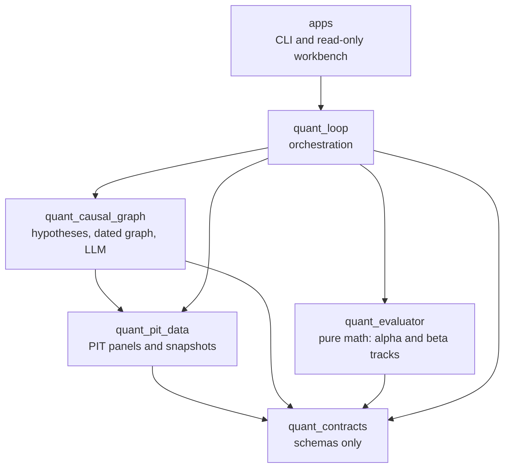

# Quant_rapper

A mid/low-frequency quant research workspace built around a point-in-time causal graph. An LLM proposes economic hypotheses and supply-chain relationships; a pure-math evaluator tests them on beta-adjusted returns; a post-market loop scores forecasts only after they mature.

> **Status:** scaffold only. The packages and folders exist, but no modules are implemented yet. Everything below describes the target architecture.

## Design principles

- **Point-in-time everywhere.** Every data row and every graph edge records when it became known. Nothing learned after a decision date may influence a historical run.
- **Alpha and beta are separate tracks.** Stock-specific signals are evaluated on returns with sector/market beta removed. Sector-level risk gets its own regime track, which can veto alpha signals.
- **No MAE for selection.** Candidates are judged by event-window abnormal returns, directional hit rate and information coefficient.
- **The LLM is fenced in.** Only `quant_causal_graph` may call an LLM. The evaluator has no LLM, network or UI dependencies, so its results are deterministic and replayable.
- **Panel from day one.** Data is keyed `(date, ticker, as_of_time)`. A single-stock study is the N=1 case of the same panel.

## Architecture



Arrows mean "depends on". Dependencies only point downward to `quant_contracts`; nothing imports from `apps`.

| Package | Role | May depend on |
| --- | --- | --- |
| `quant_contracts` | Shared schemas: PIT panel, versioned graph edge, factor recipe, evaluation report, forecast ticket. No business logic. | `pydantic` only |
| `quant_pit_data` | Connectors, release-date alignment, immutable snapshots, panel builder. | `contracts` |
| `quant_causal_graph` | Three-layer hypothesis tree (macro / industry / company), dated relationship graph with 2-hop paths, evidence mapping, replay. | `contracts`, `pit_data` |
| `quant_evaluator` | Beta neutralisation, purged and embargoed splits, event-window CAR, directional metrics, sector regime signals. | `contracts` |
| `quant_loop` | Historical ablation, post-market runs, maturity grading, feedback. | all of the above |

## Two loops that must stay separate

**Loop A: historical ablation.** A one-off, budget-limited comparison of `flat-map` against `graph-guided` discovery on frozen PIT snapshots, with a held-out window that is never fed back. Once it passes or fails, parameters are frozen; the same history is not re-tuned.

**Loop B: post-market forward loop.** After each close:

1. Pull new prices, filings, macro series and news.
2. Compute the sector beta regime first (green / yellow / red). Red overrides any stock-level long signal.
3. Update hypothesis states and write an immutable, timestamped forecast ticket for the 5- and 21-session horizons.
4. When a ticket matures, grade it against what actually happened and attribute the miss to either a beta shock or a falsified causal link.

## Roadmap

| Phase | Goal | Packages touched |
| --- | --- | --- |
| 1 | Causal chain and PIT relationship graph for a single-stock semiconductor pilot. For any historical decision date, reproducibly output candidate factors and evidence, marking what is observable and what is a data gap. | `quant_contracts`, `quant_pit_data`, `quant_causal_graph`, `configs/sectors` |
| 2 | Dual-track evaluation (beta-adjusted direction plus sector regime warning) and the post-market loop. | `quant_evaluator`, `quant_loop` |
| 3 | Extend to a 20–50 stock panel: cross-sectional ranking, correlation matrix, relative trend. | `configs/universes`, `quant_evaluator` |

## Repository layout

```
pyproject.toml      uv workspace root
packages/           the five packages above, each with its own pyproject.toml
configs/            sectors/  universes/  beta_regimes/  experiments/
apps/               cli/  workbench/
tests/              unit/  invariants/  integration/
artifacts/          snapshots/  ablations/  prospective/   (contents git-ignored)
docs/rfcs/          design documents
```

`tests/invariants/` holds the rules that must never break, such as "an edge first known after the decision date cannot guide historical discovery" and "labels never cross into the held-out window".

## Setup

Requires Python 3.12+ and [uv](https://docs.astral.sh/uv/).

```bash
uv sync
```

## Disclaimer

This is a personal research project. Nothing here is investment advice.
